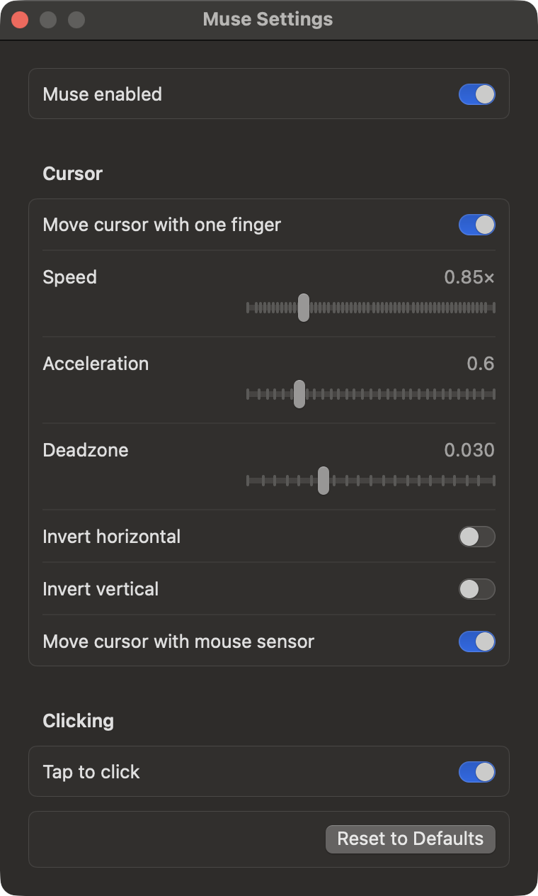
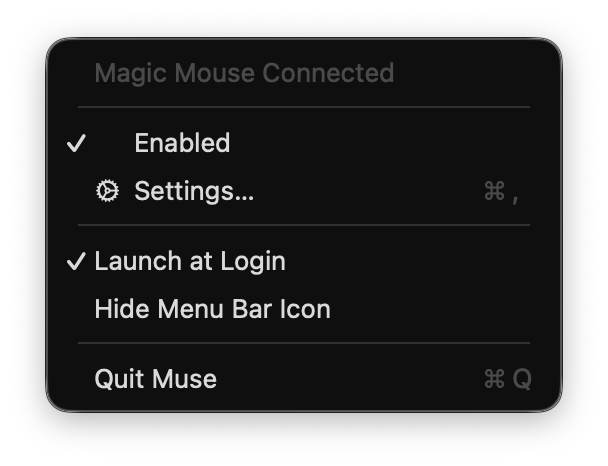

<p align="center"></p>

<h1 align="center">Muse</h1>

<p align="center">Use your Magic Mouse like a tiny trackpad on macOS.</p>

For Mac users who want to move the pointer without sliding their Magic Mouse across the desk, Muse turns its touch surface into a small trackpad.

[Product page and screenshots](https://muse.chinmaysingh.me) · [Case study](https://chinmaysingh.me/projects/muse)

<p align="center"></p>

- **One finger slides the cursor**, like on a trackpad, so you don't have to move the mouse.
- **Two fingers scroll.** Scrolling with one finger is turned off.
- **Tap to click** (optional): a quick one-finger tap is a left click.
- Moving the mouse still moves the cursor as usual, unless you turn off **Move cursor with mouse
  sensor**. Trackpads and normal scroll-wheel mice aren't affected.

Muse lives in the menu bar and doesn't use the network.

## Install

Needs macOS 13 or later and the Xcode Command Line Tools (`xcode-select --install`).

```sh
git clone https://github.com/SinghChinmayy/Muse.git
cd Muse
make install
```

This builds `Muse.app`, copies it to `~/Applications` and adds a login item so it starts on login.
Then turn on **Muse** in **System Settings → Privacy & Security → Accessibility**. It starts working
within a couple of seconds.

Each build gets a new ad-hoc signature, so after you reinstall you may need to turn Muse off and
on again in Accessibility.

## Menu bar

Click the mouse icon in the menu bar:

<p align="center"></p>

- **Status line**: shows whether the Magic Mouse is connected. If Muse is missing the
  Accessibility permission it says so, and clicking it opens the right Settings page.
- **Enabled**: pause or resume Muse. While paused the icon is dimmed and the mouse behaves
  like normal.
- **Settings…**: a small window with every setting below. Changes apply as you drag, and the
  window stays on top so you can try the mouse while tuning.
- **Launch at Login**: start Muse when you log in. Turning it off keeps Muse running until you
  log out or quit.
- **Hide Menu Bar Icon**: Muse keeps running without an icon. To bring it back, open Muse again
  from Spotlight or Finder; that also opens Settings.
- **Quit Muse**: stops Muse until the next login (or until you open it again).

## Settings

Everything is in the Settings window:

<p align="center"></p>

You can also use `defaults`; the change applies the next time you open the Muse menu or Settings
window (or run `make restart`):

| Key | Default | What it does |
|---|---|---|
| `enabled` | `true` | Muse on or off (same as **Enabled** in the menu) |
| `cursorEnabled` | `true` | One-finger cursor movement on or off |
| `cursorSpeed` | `1.0` | Cursor speed |
| `cursorAccel` | `1.0` | Extra speed for fast swipes (`0` = none) |
| `deadzone` | `0.03` | How far a finger has to slide before the cursor moves (stops jitter when clicking) |
| `invertX` / `invertY` | `false` | Flip a direction |
| `opticalEnabled` | `true` | Sliding the mouse on the desk moves the cursor. Off: only the touch surface (and the trackpad) move it |
| `tapToClick` | `false` | A quick one-finger tap on the surface is a left click; two quick taps are a double click |
| `showMenuBarIcon` | `true` | Show the menu bar icon |

```sh
defaults write io.github.singhchinmayy.Muse cursorSpeed 1.5
defaults write io.github.singhchinmayy.Muse invertY -bool true
```

## Commands

| Command | What it does |
|---|---|
| `make` | Build `build/Muse.app` |
| `make test` | Run the unit tests |
| `make coverage` | Run the unit tests and print coverage |
| `make install` | Build, install to `~/Applications` and start at login |
| `make uninstall` | Remove the app, the login item and the Accessibility entry |
| `make restart` | Restart Muse |
| `make logs` | Follow `~/Library/Logs/Muse.log` |
| `make probe` | List touch devices and show which one is the Magic Mouse |
| `make site-deploy` | Publish the landing page in `site/` to muse.chinmaysingh.me (Cloudflare Pages, needs `wrangler login`) |

To debug, stop the login item with `launchctl bootout gui/$(id -u)/io.github.singhchinmayy.Muse`, then run
`~/Applications/Muse.app/Contents/MacOS/Muse --debug`. It prints finger counts, cursor moves and blocked scrolls.

## How it works

Muse reads raw touches from the Magic Mouse through Apple's private `MultitouchSupport` framework.

- With **one finger** on the surface, it turns the finger's movement into cursor movement and drops
  the scroll events macOS would normally send.
- With **two or more fingers**, it lets scrolling (and momentum) through.
- A **quick one-finger tap** (short, barely moving, no real button press) becomes a left click.
- With the **mouse sensor off**, it drops pointer movement it didn't make itself and puts the cursor
  back. macOS doesn't say which device moved, so movement passes only while a finger is on the
  trackpad; a plain USB or Bluetooth mouse is blocked too while this is off.

Because it uses a private framework, a future macOS update could break it.

The code is a Swift package. `Sources/MuseCore` holds all the logic (touch frame parsing, finger
tracking, the scroll filter, tap detection, cursor math and placement, device detection, settings, login item,
menu status) and is fully covered by `make test`. `Sources/Muse` is the app: the
multitouch and event-tap glue in `main.swift`, the menu in `MenuBar.swift` and the Settings window
in `SettingsWindow.swift`.

## Works with

Gesture apps such as [MagicMousePad](https://github.com/rzrizaldy/MagicMousePad) can add swipes
alongside Muse (turn off their tap-to-click if you use Muse's, or a tap clicks twice). If a two-finger sideways swipe triggers back/forward while you scroll,
turn that swipe off in the other app.

## License

MIT. Not affiliated with Apple. Magic Mouse is a trademark of Apple Inc.
